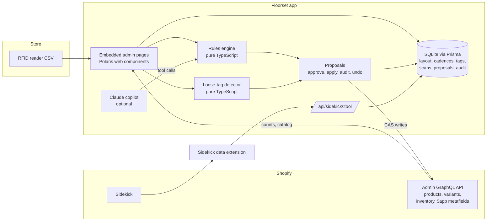

# Floorset

An embedded Shopify app for the sales floor of an apparel store. It reconciles RFID scans against Shopify inventory, finds shrink that loose tags are hiding, and recommends on-standard replacements for fixtures that can no longer hold a full size run. Every change it makes to Shopify goes through propose → approve → apply → audit log → undo.

Built on synthetic data for a mid-size apparel retailer scenario (see [Synthetic data](#synthetic-data)).

## The problem

Stores that tag every unit with RFID still run into three gaps that Shopify's inventory model doesn't cover on its own:

1. **Read rate hides shrink.** When a garment is stolen and its tag is cut off and dropped, the tag keeps reading. The count looks healthy while the stock is gone.
2. **Broken size runs stay on the floor.** A style that's out of S and M in the back still occupies its rail. Someone has to notice, then pick a replacement that has a full run, enough depth, and fits the zone's colors and the fixture's mix.
3. **Fixes are manual and untracked.** Inventory corrections and floor changes happen without a record of who changed what, or a way to reverse it.

## What it does

| Page | What it shows |
| --- | --- |
| **Scans** | Upload a CSV from the handheld reader (`epc,area,read_at`) as a full count or a morning floor scan. Rows are validated, duplicates merged, and loose-tag detection re-runs. |
| **Read rate** | Latest full count against Shopify on-hand: raw rate, adjusted rate (excluding suspected loose tags), by category and SKU against a 95% target, and SKUs that come up short count after count. |
| **Loose tags** | Suspects with a confidence score and the signals behind it, hotspots by area, a sweep list grouped by area, and a resolve flow. A confirmed loose tag proposes an inventory correction in Shopify. |
| **Replenishment** | This morning's floor scan against each fixture's size cadence and back stock: a fill list ("bring out 2 M") and swap-outs (items that can't hold their run). |
| **Fixture view** | For a swap-out: top 3 replacements with plain-English reasons, every rejected item with the rule that blocked it, before/after color blocks, refine buttons, and the swap proposal. |
| **Sidekick** | Three read-only tools so Shopify's assistant can answer "what's my read rate?", "what needs replacing?", "where are the loose tags?" |

An optional Claude copilot on the fixture view turns requests like "something brighter, not a legging" into ranking preferences. It can only propose items the rules engine already passed.

## Demo (5 minutes)

1. **Read rate.** The store reads 98%, which looks fine. Bras sit at 93%, and every chronic short is a bra: steady theft.
2. **Loose tags.** 26 suspects, clustered in the fitting room and one entrance corner. Raw read rate is above adjusted because these tags are still counted. Mark one "Tag only"; a correction is proposed. Approve it and Shopify's available count drops by one. Undo puts it back.
3. **Replenishment.** 7 items can't hold their size run. Click **Find replacement**.
4. **Fixture view.** The before row shows the rail; the after row shows it with the top pick. Each pick says why in plain English (size run, back stock, palette fit, its neighbors, sales). Each rejection names the rule that blocked it. Press **Brighter**, then propose, approve, and undo a swap.
5. **Sidekick.** Ask "Which floor items need replacing?" and follow the link back to the fixture view.

## Architecture



Shopify stays the source of truth for products and counts. The app database holds what Shopify doesn't model: the floor layout, size cadences, one row per RFID tag, raw scan reads, loose-tag suspects, proposals, and the audit log.

## Design decisions

- **A deterministic rules engine, with the LLM kept at the edge.** Ranking is pure functions: stock rules (full size run, 2× depth, not damaged, fixture type, department), then preferences, then visual standards (zone palette, color adjacency, max 2 styles per category), then a weighted score. The engine is unit-tested and explainable. The copilot can only change preferences, which narrow or re-weight; it can't loosen a rule, and its propose tool rejects anything outside the engine's current picks.
- **Leniency only when nothing passes.** If no item has stock to refill the slot twice, the engine re-ranks accepting items that fill the size run once, and labels them as fallback picks. A broken run is never offered.
- **Every write is a proposal.** Nothing touches Shopify until a person approves it. Applying claims the proposal first (no double apply), re-checks preconditions, and writes with compare-and-swap: `metafieldsSet` with `compareDigest` for placements, and `inventoryAdjustQuantities` with `changeFromQuantity` and an `@idempotent` key for corrections. The audit row stores before and after, and undo refuses if anything changed since.
- **Loose-tag signals that hold up under re-merchandising.** Detection first flagged tags read outside their own zone. That produced false alarms after a real swap moved stock between zones, so "wrong area" now means outside every sales zone and the stockroom. Signals combine as 1 − Π(1 − weight).
- **Sidekick answers from cached summaries.** Sidekick data tools must respond within 1 second, too short for a live catalog read. Pages save a trimmed summary as they load (under 800 tokens each) and the tools read it back with an `asOf` time.
- **No action extension.** Sidekick action intents are a fixed list of types, none of which fits "fixture swap". Rather than mislabel it, the swap-out tool returns a link to the fixture view, where the swap is staged and approved.

## Results on the synthetic data

| Check | Result |
| --- | --- |
| Planted bra theft (5% of units) | Bras read 93% vs 95% target; every chronic-short SKU is a bra |
| Loose-tag detection | 26 flagged, 26 planted, 0 false alarms. The 22 planted tags dropped at their own fixture are not flagged: they look exactly like stock on the floor, which is the limit of scan-only detection |
| Swap-outs | 7 found; 6 have valid replacements, 1 is blocked by the fixture's color and category mix |
| Write path | Propose → apply → undo verified against a dev store for both metafield swaps and inventory corrections |

## What I'd change at scale

- **Multi-store and multi-location.** Add a `shop` column to every table and a location picker. Today it's single-store with the first location.
- **Sync instead of re-fetch.** The catalog is re-read per page load (about 6 Admin API calls). At scale, sync it with bulk operations plus `products/update` and `inventory_levels/update` webhooks.
- **Scans as a stream.** Reader uploads would go to object storage and a queue. Reads would land in a columnar store, and per-SKU rollups would be computed incrementally.
- **Sales from orders.** Sales velocity comes from a seeded daily rollup. In production it would come from `orders/create` webhooks.
- **Summaries on a schedule.** Sidekick summaries refresh when a page loads; a scheduled job would keep them fresh.
- **Postgres.** SQLite is fine for one store. Proposals and audit rows would move to Postgres with row-level locking.

## Running locally

Requires Node 22.12+, the Shopify CLI, a Partner account and a development store.

```sh
npm install
npm run dev                                   # shopify app dev; install the app on your dev store
npm run seed -- <store>.myshopify.com         # 150 products, inventory, layout, RFID units, sales
npm run gen-scans                             # writes scans/*.csv
```

Then upload the CSVs from `scans/` on the **Scans** page, oldest first. The seed is rerunnable: it deletes the products it created before (tagged `floorset-seed`).

The copilot is optional. Add `ANTHROPIC_API_KEY=...` to `.env` to show it.

```sh
npm test            # Vitest: rules engine, scan parsing, reconciliation, loose-tag detection
npm run typecheck
npm run lint
```

## Synthetic data

All products, colors, zones, cadences, stock, sales and scans are generated by a seeded generator in `scripts/`. The planted problems (bra theft, loose tags in the fitting room and an entrance corner, sold items whose tags still read, broken size runs) are recorded in `scans/truth.json` so detection can be scored. No real company data, figures or system names are used.
