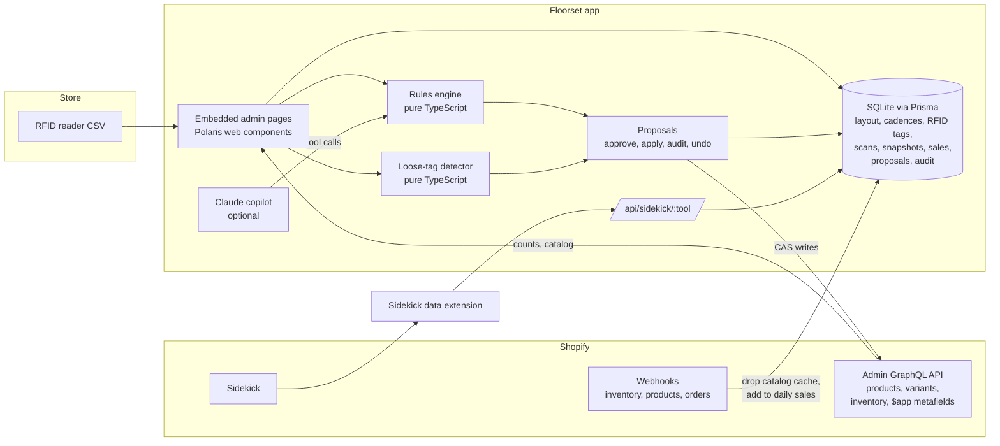

# Floorset

[](https://github.com/dvnyvo/floorset/actions/workflows/ci.yml)

An embedded Shopify app for the sales floor of an apparel store. It reconciles RFID scans against Shopify inventory, finds shrink that loose tags are hiding, and recommends on-standard replacements for fixtures that can no longer hold a full size run. Every change it makes to Shopify goes through propose → approve → apply → audit log → undo.

Built on synthetic data for a mid-size apparel retailer scenario (see [Synthetic data](#synthetic-data)).

## The problem

Stores that tag every unit with RFID still run into three gaps that Shopify's inventory model doesn't cover on its own:

1. **Read rate hides shrink.** When a garment is stolen and its RFID-encoded tag is cut off and dropped, the tag keeps reading. The count looks healthy while the stock is gone.
2. **Broken size runs stay on the floor.** A style that's out of S and M in backstock still occupies its rail. Someone has to notice, then pick a replacement that has a full run, enough depth, and fits the zone's colors and the fixture's mix.
3. **Fixes are manual and untracked.** Inventory corrections and floor changes happen without a record of who changed what, or a way to reverse it.

## What it does

| Page | What it shows |
| --- | --- |
| **Floor map** (home) | The store floor drawn from a made-up floor plan: each fixture colored and labeled by status (needs replacing, needs fill, OK), loose-tag counts on the fitting room, entrance, cash wrap and back corridor, and a panel per fixture with its slots, swap-out reasons and fill items. |
| **Scans** | Upload a CSV from the handheld reader (`epc,area,read_at`) as a weekly inventory scan or a morning floor scan. Rows are validated, duplicates merged, and loose-tag detection re-runs. |
| **Read rate** | Latest inventory scan against Shopify on-hand: raw rate, adjusted rate (excluding suspected loose tags), by category and SKU against a 95% target, SKUs that come up short scan after scan, and a chart of the rate over time. |
| **Loose tags** | Suspects with a confidence score and the signals behind it, hotspots by area, a sweep list grouped by area, and a resolve flow. A confirmed loose tag proposes an inventory correction in Shopify. |
| **Replenishment** | This morning's floor scan against each fixture's size cadence and backstock: a fill list ("bring out 2 M") and swap-outs (items that can't hold their run). |
| **Fixture view** | For a swap-out: top 3 replacements with plain-English reasons, every rejected item with the rule that blocked it, before/after color blocks, refine buttons, and the swap proposal. |
| **Sidekick** | Three read-only tools so Shopify's assistant can answer "what's my read rate?", "what needs replacing?", "where are the loose tags?" |

An optional Claude copilot on the fixture view turns requests like "something brighter, not a legging" into ranking preferences. It can only propose items the rules engine already passed.

## Demo (5 minutes)

1. **Read rate.** The store reads 96.1%, above the 95% target. With suspected loose tags taken out it reads 92.3%: 3.8 points of shrink the headline number hides. The chart shows the adjusted rate holding near 96% for six counts and then falling as loose tags pile up, while bras slide from 95% to 89%.
2. **Loose tags.** 255 suspects, almost all in four spots where no stock belongs: the fitting room, an entrance corner, the cash wrap and a back corridor. Mark one "RFID tag only"; a correction is proposed. Approve it and Shopify's available count drops by one. Undo puts it back.
3. **Replenishment.** 8 items can't hold their size run. Click **Find replacement** on Zone 2 Rail 2.
4. **Fixture view.** The before row shows the rail grouped into outfits, each slot labelled with the role it needs; the after row shows it with the top pick. Each pick says why in plain English (size run, backstock, palette fit, its neighbors, sales). Each rejection names the rule that blocked it. Press **Brighter**, then propose, approve, and undo a swap. Zone 1 Rail 1, slot 2 has no valid pick; it lists the closest options instead, each labeled with the one rule it breaks.
5. **Sidekick.** Ask "Which floor items need replacing?" and follow the link back to the fixture view.

## Architecture



Shopify stays the source of truth for products and counts. The app database holds what Shopify doesn't model: the floor layout, size cadences, one row per RFID tag, raw scan reads, read-rate snapshots, daily sales, loose-tag suspects, proposals, and the audit log.

## Design decisions

- **A deterministic rules engine, with the LLM kept at the edge.** Ranking is pure functions: stock rules (full size run, 2× depth, not damaged, fixture type, department), then preferences, then visual standards (outfit role, zone palette, color adjacency), then a weighted score. The engine is unit-tested and explainable. The copilot can only change preferences, which narrow or re-weight; it can't loosen a rule, and its propose tool rejects anything outside the engine's current picks.
- **Fixtures are merchandised as outfits.** Every 3 rail slots form one outfit, and each slot needs a role: top (bra, tank, tee, shirt), bottom (legging, short, jogger, trouser) or cover-up (jacket, long sleeve, hoodie, all outerwear). Women's rails run top → bottom → cover-up, men's run cover-up → top → bottom. Tables take tops and non-outerwear cover-ups on the left half and bottoms on the right; outerwear never goes on a table. Role is its own product metafield, separate from category: a long sleeve is a top by category and a cover-up by role. A wrong-role item is rejected with the slot's rule ("Slot 3 is a cover-up slot (top → bottom → cover-up)"). The sequence already limits each role per fixture, so there is no separate per-category cap.
- **Score weights: contrast 0.40, velocity 0.35, cover 0.25.** With roles fixed by the slot, the score ranks items that already fit: contrast is how far its color is from the neighbors (hue and lightness combined, 0 for the same color family, so a purple next to a red still scores), velocity is sales against the fastest seller in the whole category, and cover is weeks of supply in backstock, full at 4+ weeks. "More contrast" raises contrast to 0.80.
- **Closest options, never proposable.** When nothing passes, the view lists up to 3 items that break exactly one visual rule (zone palette or color adjacency), labeled with that rule, e.g. "Fits everything except Zone 1's palette". Stock rules, preferences and the slot's role are never relaxed for them, and the propose action only accepts real picks.
- **Leniency only when nothing passes.** If no item has stock to refill the slot twice, the engine re-ranks accepting items that fill the size run once, and labels them as fallback picks. A broken run is never offered.
- **Every write is a proposal.** Nothing touches Shopify until a person approves it. Applying claims the proposal first (no double apply), re-checks preconditions, and writes with compare-and-swap: `metafieldsSet` with `compareDigest` for placements, and `inventoryAdjustQuantities` with `changeFromQuantity` and an `@idempotent` key for corrections. The audit row stores before and after, and undo refuses if anything changed since.
- **Loose-tag signals that hold up under re-merchandising.** Detection first flagged RFID-encoded tags read outside their own zone. That produced false alarms after a real swap moved stock between zones, so "wrong area" now means outside every sales zone and the stockroom. Signals combine as 1 − Π(1 − weight).
- **Sidekick answers from cached summaries.** Sidekick data tools must respond within 1 second, too short for a live catalog read. Pages save a trimmed summary as they load (under 800 tokens each) and the tools read it back with an `asOf` time.
- **A cached catalog that webhooks keep honest.** A full catalog read is about 6 Admin API calls, so it is cached in memory. `inventory_levels/update`, `products/update` and `products/delete` webhooks drop the cache, and so do the app's own writes, so a page never shows a count the app itself just changed. A 5-minute limit covers a missed webhook.
- **Sales from order webhooks, counted once.** The `orders/create` handler adds each line to a per-variant daily rollup that feeds sales velocity. Shopify can deliver a webhook more than once, so the delivery ID and the rollup update are written in one transaction; a repeat delivery fails the unique check and changes nothing. Shopify only delivers order webhooks to apps with protected customer data access, which is selected for the app in the Partner Dashboard (no review needed for development stores). The handler reads line items only and stores no customer fields.
- **Read-rate history as snapshots.** When an inventory scan is uploaded, the rate per category is frozen against on-hand at that moment. The trend chart reads those few rows and never re-reads old scans or guesses past inventory.
- **No action extension.** Sidekick action intents are a fixed list of types, none of which fits "fixture swap". Rather than mislabel it, the swap-out tool returns a link to the fixture view, where the swap is staged and approved.

## Results on the synthetic data

| Check | Result |
| --- | --- |
| Raw vs adjusted read rate (latest inventory scan, 6,730 units on hand) | 96.1% raw, 92.3% adjusted. The raw rate passes the 95% target; the adjusted rate fails it |
| Planted bra theft (5% of units, RFID tags gone, building up over six weeks) | Bras fall from 95% to 89% across eight inventory scans |
| Loose-tag detection | 277 planted, 255 flagged, 0 false alarms. The 22 planted RFID-encoded tags dropped at their own fixture are not flagged: they look exactly like stock on the floor, which is the limit of scan-only detection |
| Swap-outs | 8 found; 7 have valid replacements. 1 (Zone 1 Rail 1, slot 2) is planted with no valid pick and shows 3 closest options |
| Write path | Propose → apply → undo verified against a dev store for both metafield swaps and inventory corrections |

## What I'd change at scale

- **Multi-store and multi-location.** Add a `shop` column to every table and a location picker. Today it's single-store with the first location.
- **Sync instead of cache.** The catalog cache is in memory and dropped whole on any change. At scale, sync the catalog into the database with bulk operations and apply webhooks row by row.
- **Admin API rate limits.** The GraphQL Admin API charges each query a cost against a bucket that refills over time. The app makes a few calls per page and does not retry a throttled one. With many stores it would read the throttle status returned with each response, back off and retry on a throttled error, and move full catalog reads to bulk operations, which run outside that budget.
- **Webhook backfills.** Shopify retries a failed delivery for a limited time and then drops it. The 5-minute cache limit covers a missed inventory webhook, but a missed order never reaches the sales rollup. A scheduled job would re-read orders changed since the last one processed and add any that are missing, using the same once-only check.
- **Scans as a stream.** Reader uploads would go to object storage and a queue. Reads would land in a columnar store, and per-SKU rollups would be computed incrementally.
- **Net sales.** The sales rollup counts units ordered. Refunds and cancellations would be subtracted via `refunds/create` and `orders/cancelled`.
- **Summaries on a schedule.** Sidekick summaries refresh when a page loads; a scheduled job would keep them fresh.
- **Postgres and hosting.** SQLite is fine for one store. Proposals and audit rows would move to Postgres with row-level locking, and the app would be deployed from the included Dockerfile. It currently runs only through `shopify app dev`.

## Future work

- **Signal weights that learn.** The loose-tag signal weights are fixed. The app records every false alarm ("item found") but does not yet use them; the next step is to lower a signal's weight as its false alarms add up.
- **A Sidekick action.** Sidekick can read from Floorset but cannot stage a swap; it links to the fixture view instead.
- **Deployment.** Not hosted anywhere yet.

## Running locally

Requires Node 22.12+, the Shopify CLI, a Partner account and a development store.

```sh
npm install
npm run dev                                   # shopify app dev; install the app on your dev store
npm run seed -- <store>.myshopify.com         # 163 products, inventory, layout and floor plan, RFID units, sales
npm run seed-floor-plan                       # floor plan only, for a database seeded before the map existed
npm run gen-scans                             # writes scans/*.csv (8 weekly inventory scans, 4 floor scans)
```

Then upload the CSVs from `scans/` on the **Scans** page, oldest first. `scans/messy/reader_export.csv` is a deliberately bad export (reordered columns, repeat reads, invalid EPCs and dates, RFID-encoded tags the store doesn't own) for trying the parser; delete that scan afterwards so it doesn't count as the latest. The seed is rerunnable: it deletes the products it created before (tagged `floorset-seed`).

The copilot is optional. Add `ANTHROPIC_API_KEY=...` to `.env` to show it.

```sh
npm test            # Vitest: rules engine, scan parsing (incl. the generated files), reconciliation, loose-tag detection, sales rollup
npm run typecheck
npm run lint
```

## Synthetic data

All products, colors, zones, cadences, stock, sales and scans are generated by a seeded generator in `scripts/`. The planted problems (bra theft that builds week by week, loose tags dumped in the fitting room, an entrance corner, the cash wrap and a back corridor, sold items whose tags still read, broken size runs) are recorded in `scans/truth.json` so detection can be scored. No real company data, figures or system names are used.
