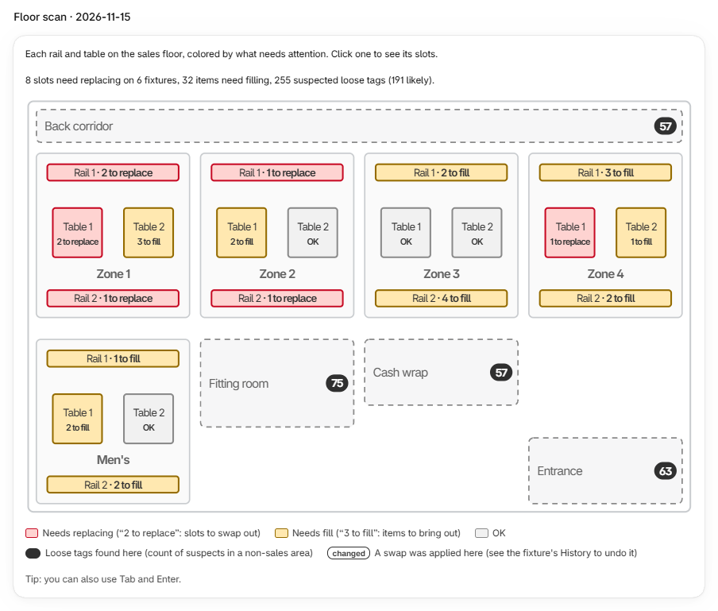
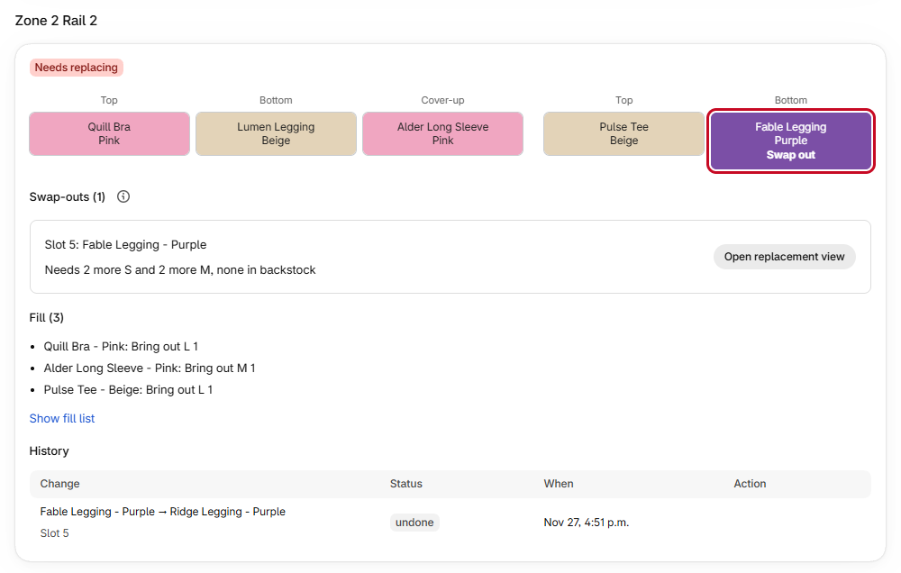
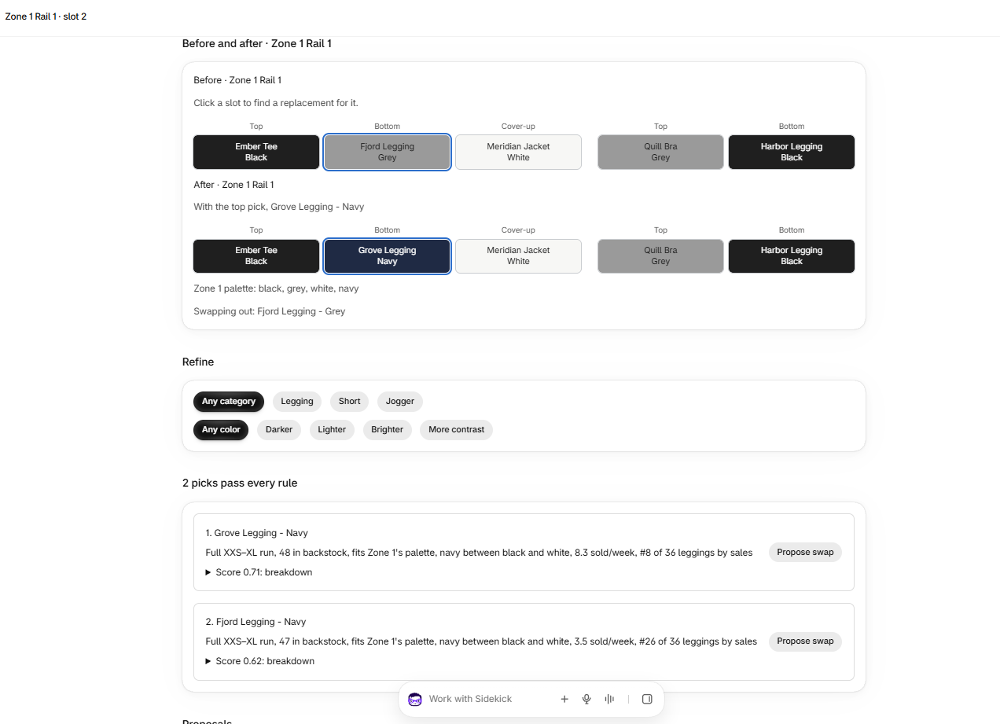
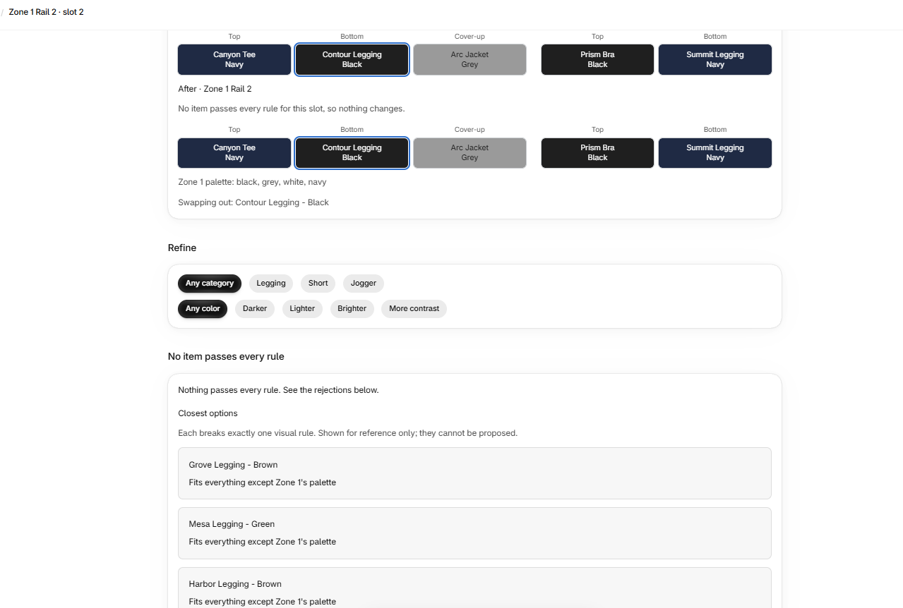
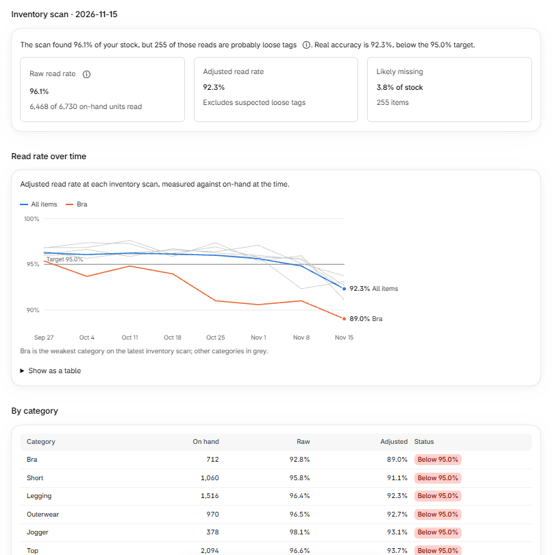
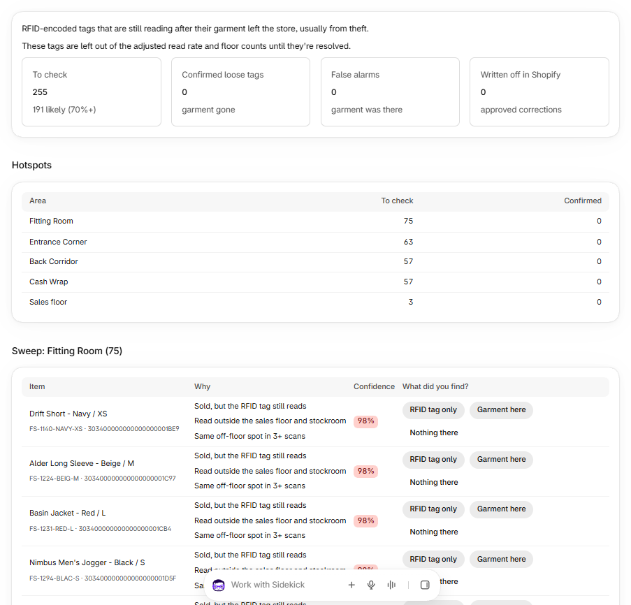
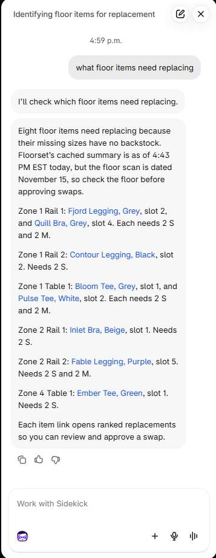
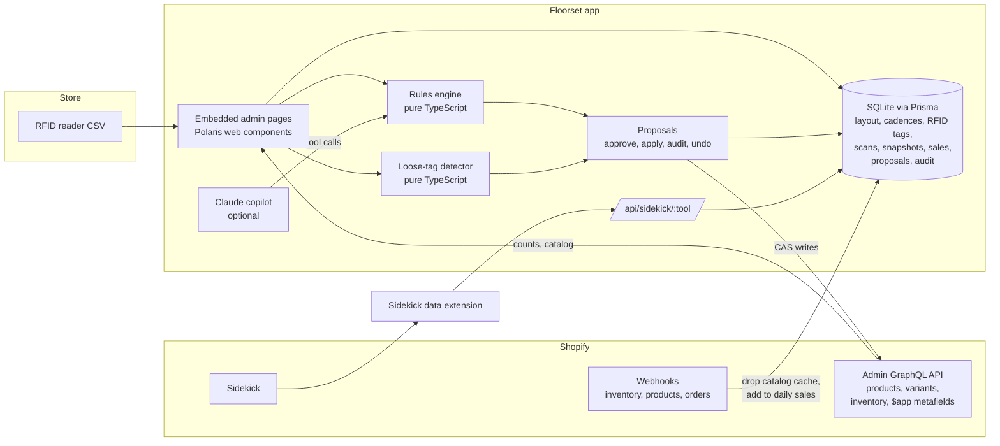

# Floorset

[](https://github.com/dvnyvo/floorset/actions/workflows/ci.yml)

A Shopify app that shows an apparel store what's really on its shelves, where stock is quietly going missing, and what each rack needs next.

Built from my experience as a stockroom associate in an RFID-tagged apparel store.



**26-second demo**

https://github.com/user-attachments/assets/bade499e-638f-4f8f-bd13-3543fecbe957

## What it does

- **Finds stock that's missing even when the count looks fine.** RFID scans say 96.1% of stock is there; once tags left behind by theft are taken out, it's 92.3%.
- **Shows where stolen items' tags are being dumped** (fitting room, cash wrap, entrance, back corridor) and proposes the matching inventory fix in Shopify.
- **Tells floor staff what to refill and what to replace on each rack,** with a plain-English reason for every pick. Nothing changes in Shopify until a person approves it, and every change can be undone.

## How to use it

**1. Floor map.** Click a red rack. A panel shows its slots, the item that has to be replaced and why, what to bring out from backstock, and the rack's change history.



**2. Replacement view.** Click **Open replacement view**. You see the rack before and after the top pick, and each pick says why it was chosen: size run, backstock, zone colors, its neighbors and sales.



When nothing fits, as on Zone 1 Rail 2, slot 2, the view lists the closest options instead, each labeled with the one rule it breaks.



**3. Read rate.** The scan found 96.1% of the stock, above the 95% target. With loose tags taken out, real accuracy is 92.3%, and the chart shows bras falling fastest.



**4. Loose tags.** Hotspots show where cut-off tags are being dumped. The sweep list below says why each tag was flagged, and you mark what you found.



**5. Sidekick.** Ask Shopify's assistant "Which floor items need replacing?" It answers from Floorset's data and links back to the replacement view.



## Results (on synthetic test data)

- **255 of 277 planted loose tags flagged, 0 false alarms.**
- **The scan reads 96.1%, but real accuracy is 92.3%.**
- **135 tests passing.**

## Built with

TypeScript, React Router, Shopify Admin GraphQL, Polaris, Sidekick app extensions, Prisma, SQLite, Vitest.

## 30-second glossary

- **RFID-encoded tag.** A tag in each garment with its own ID (its EPC), which a handheld reader picks up without needing to see it.
- **Read rate.** The share of the stock Shopify says is on hand that an RFID scan actually found; the target is 95%.
- **Loose tag.** An RFID-encoded tag that still reads after its garment has left the store, usually because it was cut off during a theft.
- **Size run / swap-out.** The sizes a fixture shows for one item, for example 1 XXS, 2 XS, 3 S, 3 M, 2 L and 1 XL on a rail. An item whose size run can't be refilled from backstock, so it's replaced with a different item that can.
- **Backstock.** Stock kept in the stockroom, used to refill the sales floor.


## Architecture



Shopify stays the source of truth for products and counts. The app database holds what Shopify doesn't model: the floor layout, size cadences, one row per RFID tag, raw scan reads, read-rate snapshots, daily sales, loose-tag suspects, proposals, and the audit log.

## Design decisions

- **A deterministic rules engine, with the LLM kept at the edge.** Ranking is pure functions: stock rules (full size run, 2× depth, not damaged, fixture type, department), then preferences, then visual standards (outfit role, zone palette, color adjacency), then a weighted score. The engine is unit-tested and explainable. The copilot can only change preferences, which narrow or re-weight; it can't loosen a rule, and its propose tool rejects anything outside the engine's current picks.
- **Fixtures are merchandised as outfits.** Every 3 rail slots form one outfit, and each slot needs a role: top (bra, tank, tee, shirt), bottom (legging, short, jogger, trouser) or cover-up (jacket, long sleeve, hoodie, all outerwear). Women's rails run top → bottom → cover-up, men's run cover-up → top → bottom. Tables take tops and non-outerwear cover-ups on the left half and bottoms on the right; outerwear never goes on a table. Role is its own product metafield, separate from category: a long sleeve is a top by category and a cover-up by role. A wrong-role item is rejected with the slot's rule ("Slot 3 is a cover-up slot (top → bottom → cover-up)"). The sequence already limits each role per fixture, so there is no separate per-category cap.
- **Every write is a proposal.** Nothing touches Shopify until a person approves it. Applying claims the proposal first (no double apply), re-checks preconditions, and writes with compare-and-swap: `metafieldsSet` with `compareDigest` for placements, and `inventoryAdjustQuantities` with `changeFromQuantity` and an `@idempotent` key for corrections. The audit row stores before and after, and undo refuses if anything changed since.
- **Loose-tag signals that hold up under re-merchandising.** Detection first flagged RFID-encoded tags read outside their own zone. That produced false alarms after a real swap moved stock between zones, so "wrong area" now means outside every sales zone and the stockroom. Signals combine as 1 − Π(1 − weight).
- **Sidekick answers from cached summaries, with no action extension.** Sidekick data tools must respond within 1 second, too short for a live catalog read. Pages save a trimmed summary as they load (under 800 tokens each) and the tools read it back with an `asOf` time. Sidekick action intents are a fixed list of types, none of which fits "fixture swap". Rather than mislabel it, the swap-out tool returns a link to the fixture view, where the swap is staged and approved.

More decisions (score weights, closest options, leniency, catalog cache, sales webhooks, read-rate snapshots) are in [docs/design.md](docs/design.md).

### Results on the synthetic data

| Check | Result |
| --- | --- |
| Raw vs adjusted read rate (latest inventory scan, 6,730 units on hand) | 96.1% raw, 92.3% adjusted. The raw rate passes the 95% target; the adjusted rate fails it |
| Planted bra theft (5% of units, RFID tags gone, building up over six weeks) | Bras fall from 95% to 89% across eight inventory scans |
| Loose-tag detection | 277 planted, 255 flagged, 0 false alarms. The 22 planted RFID-encoded tags dropped at their own fixture are not flagged: they look exactly like stock on the floor, which is the limit of scan-only detection |
| Swap-outs | 8 found; 7 have valid replacements. 1 (Zone 1 Rail 2, slot 2) is planted with no valid pick and shows 3 closest options |
| Write path | Propose → apply → undo verified against a dev store for both metafield swaps and inventory corrections |

### What I'd change at scale

- **Multi-store and multi-location.** Add a `shop` column to every table and a location picker. Today it's single-store with the first location.
- **Admin API rate limits.** The GraphQL Admin API charges each query a cost against a bucket that refills over time. The app makes a few calls per page and does not retry a throttled one. With many stores it would read the throttle status returned with each response, back off and retry on a throttled error, and sync the catalog into the database with bulk operations, which run outside that budget, applying webhooks row by row instead of dropping the whole in-memory cache on any change.
- **Webhook backfills.** Shopify retries a failed delivery for a limited time and then drops it. The 5-minute cache limit covers a missed inventory webhook, but a missed order never reaches the sales rollup. A scheduled job would re-read orders changed since the last one processed and add any that are missing, using the same once-only check.
- **Scans as a stream.** Reader uploads would go to object storage and a queue. Reads would land in a columnar store, and per-SKU rollups would be computed incrementally.
- **Postgres and hosting.** SQLite is fine for one store. Proposals and audit rows would move to Postgres with row-level locking, and the app would be deployed from the included Dockerfile. It currently runs only through `shopify app dev`.

### Future work

- **Signal weights that learn.** The loose-tag signal weights are fixed. The app records every false alarm ("item found") but does not yet use them; the next step is to lower a signal's weight as its false alarms add up.

### Tests

```sh
npm test            # Vitest: rules engine, scan parsing (incl. the generated files), reconciliation, loose-tag detection, sales rollup
npm run typecheck
npm run lint
```

### Running locally

Requires Node 22.12+, the Shopify CLI, a Partner account and a development store.

```sh
npm install
npm run dev                                   # shopify app dev; install the app on your dev store
npm run seed -- <store>.myshopify.com         # 163 products, inventory, layout and floor plan, RFID units, sales
npm run gen-scans                             # writes scans/*.csv (8 weekly inventory scans, 4 floor scans)
```

Then upload the CSVs from `scans/` on the **Scans** page, oldest first. `scans/messy/reader_export.csv` is a deliberately bad export (reordered columns, repeat reads, invalid EPCs and dates, RFID-encoded tags the store doesn't own) for trying the parser; delete that scan afterwards so it doesn't count as the latest. The seed is rerunnable: it deletes the products it created before (tagged `floorset-seed`).

The copilot is optional. Add `ANTHROPIC_API_KEY=...` to `.env` to show it.

### Synthetic data

All products, colors, zones, cadences, stock, sales and scans are generated by a seeded generator in `scripts/`. The planted problems (bra theft that builds week by week, loose tags dumped in the fitting room, an entrance corner, the cash wrap and a back corridor, sold items whose tags still read, broken size runs) are recorded in `scans/truth.json` so detection can be scored. No real company data, figures or system names are used.
